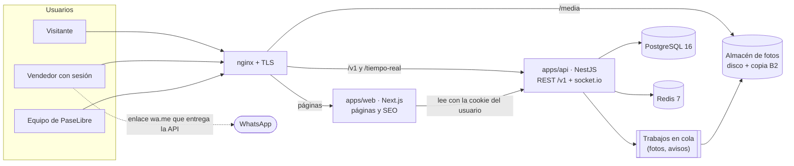
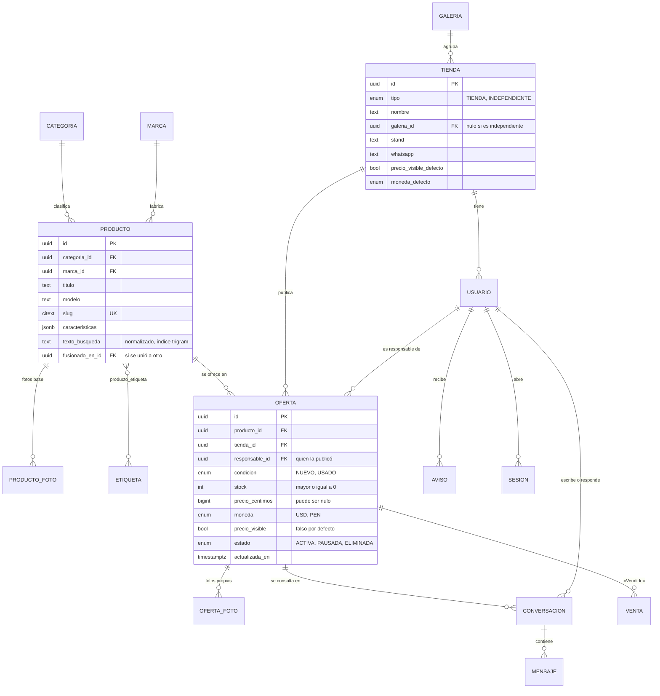
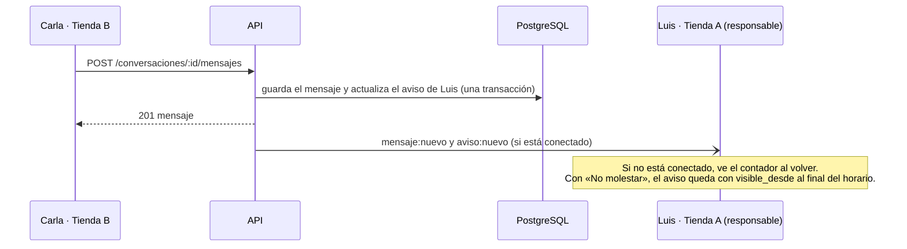

# 05 · Arquitectura

**Versión:** 0.2 (borrador) · **Fecha:** 26/10/2026 · **Responsable:** Dazz

**Decidido el 26/10:** se reutiliza el stack de Yallegó (A-01) y la bandeja de mensajes es **por persona** (A-11). El servidor se elige al final (A-10).

## Cómo leer este documento

Esta es la propuesta técnica para construir la primera salida antes del 31/10. Parte de cuatro fuentes:
- los requerimientos ([02](02-requerimientos-funcionales.md) y [03](03-requerimientos-no-funcionales.md));
- las decisiones del [documento 04](04-decisiones-para-la-reunion.md);
- el **mapa de pantallas y rutas** del [lienzo de diseño](https://claude.ai/artifact/H9iqh18AbknFVzzuRZPK1A), en la página «Línea final · todas las pantallas»;
- el **modelo de productos y ofertas** (D-43).

- **A-xx** son decisiones de arquitectura. Las que dicen *(por confirmar)* esperan el visto bueno de Dazz o del equipo.
- Los nombres de tablas, rutas y campos están en español, igual que la interfaz. El código (clases, funciones) puede ir en inglés si el equipo lo prefiere, pero los contratos de la API usan estos nombres.

---

## 1. Principios

1. **Llegar al 31/10 con lo que ya conocemos.** Se reutiliza el stack y la forma de desplegar de Yallegó, que Dazz ya opera en producción (RNF-35).
2. **El servidor decide qué ve cada quien.** El precio, la tienda, el stand y el WhatsApp nunca salen hacia quien no tiene sesión, aunque la interfaz los esconda (RNF-18, RNF-50, R-15).
3. **Producto y oferta separados desde el primer día.** Es lo único que no se recorta: cambiarlo después obliga a migrar todo el catálogo (D-43, documento 04).
4. **Una sola API para la web y para la futura app.** Las mismas cuentas, los mismos datos y los mismos contratos (RNF-47).
5. **Postgres primero.** No se suma un servicio nuevo (buscador, cola externa, CDN) hasta que un número lo pida (RNF-34).

## 2. Decisiones de arquitectura

| ID | Decisión | Alternativa descartada | Por qué |
| --- | --- | --- | --- |
| A-01 | **Monorepo pnpm** con `apps/web` (Next.js 15), `apps/api` (NestJS 11), `packages/contracts` (Zod), `packages/ui` (tokens y componentes del lienzo) y `packages/config` | Una sola app Next.js con la API dentro | Es la estructura de Yallegó: se copian la configuración, los Dockerfile y los scripts de despliegue. La app del celular reutiliza la API y los contratos sin tocar la web |
| A-02 | **PostgreSQL 16 + Prisma 6**, con las extensiones `pg_trgm`, `unaccent`, `fuzzystrmatch` y `citext` | Meilisearch o Typesense desde el inicio | Con cientos de tiendas y decenas de miles de ofertas (RNF-28), Postgres resuelve la búsqueda tolerante en menos de 1 s. Un buscador aparte es otro servicio que sincronizar y respaldar. Criterio para cambiar en la sección 7 |
| A-03 | **Redis 7** para el adaptador de socket.io, los límites de peticiones y las colas (BullMQ) | Sin Redis | Ya está en el stack. Hace falta para el tiempo real con más de un proceso y para procesar fotos sin frenar la API |
| A-04 | **Tiempo real con socket.io** sobre la misma API, con el adaptador de Redis | Consultar cada pocos segundos (*polling*) | Cumple RNF-48 (menos de 5 s) y ya se usa en Yallegó. Si el socket se cae, la interfaz vuelve a pedir lo pendiente al reconectar |
| A-05 | **Sesión con cookie** `httpOnly` y un token opaco guardado como *hash* en la tabla `sesion`. Contraseñas con **argon2id**. La app usará el mismo token como `Bearer` | JWT sin estado | Suspender una cuenta corta la sesión al instante. Deja lista la lista de sesiones abiertas de la fase 2 (RF-67) |
| A-06 | **Respuestas por audiencia:** cada recurso tiene un contrato para visitante, otro para vendedor y otro para el dueño de la oferta. Las consultas de visitante **no seleccionan** las columnas de precio ni de tienda | Filtrar en la interfaz | Es la única forma de garantizar RNF-18 y RNF-50. Una prueba automática revisa que el JSON público no traiga esos campos |
| A-07 | **WhatsApp a pedido:** el número no viaja en la página. El botón llama a `POST /v1/ofertas/:id/contacto` y la API devuelve el enlace `wa.me` con el mensaje armado | Poner el enlace en el HTML | Protege los números del *scraping* (RNF-19), registra el clic (RF-23) y deja fuera al visitante (RNF-50) |
| A-08 | **Fotos:** se suben a la API, que valida tipo y tamaño, quita los metadatos (EXIF) y genera WebP en 3 tamaños con `sharp`. Se guardan detrás de una interfaz `Almacen`, con disco local en el MVP y copia nocturna a Backblaze B2 | Subir directo a un *bucket* desde el navegador | Menos piezas para el 31/10 y sin costo extra. Pasar a R2 o B2 después es cambiar el adaptador, no el código |
| A-09 | **Next.js renderiza en el servidor** las páginas públicas (portada, búsqueda y ficha) para que los buscadores las indexen (RNF-42). Como nunca llevan datos privados, se pueden cachear. Las páginas con sesión responden `no-store` | Todo en el navegador | SEO, carga rápida en 4G (RNF-10) y ningún riesgo de que una caché sirva un precio a un visitante |
| A-10 | **Docker Compose en un VPS** con nginx, Let's Encrypt, y entornos de *staging* y producción. *Se decide al final si es un VPS nuevo o el de Yallegó*; el mismo `compose.yml` sirve para los dos | Vercel + base administrada | Costo fijo y bajo (RNF-34), el mismo flujo de despliegue que Yallegó y sin límites de WebSocket |
| A-11 | **Bandeja de mensajes por persona.** Cada hilo es entre dos personas: quien escribe y el **responsable** de la oferta, que es quien la publicó. Los demás usuarios de la tienda no lo ven | Bandeja compartida por tienda | Decisión de Dazz (26/10). Cada asesor responde lo suyo. Para que no queden hilos sin dueño, el equipo puede cambiar el responsable de una oferta y de sus hilos (sección 8) |

## 3. Vista general



| Pieza | Qué hace | Qué no hace |
| --- | --- | --- |
| **nginx** | TLS, compresión, sirve `/media` con caché larga, pasa `/v1` y el WebSocket a la API y el resto a la web | No guarda en caché nada con cookie de sesión |
| **Web (Next.js)** | Pantallas del lienzo, SEO, formularios. En el servidor llama a la API con la cookie del usuario | No habla con la base de datos ni decide permisos |
| **API (NestJS)** | Reglas de negocio, permisos, contratos por audiencia, búsqueda, chat en tiempo real y avisos | No arma HTML |
| **Cola (BullMQ en la API)** | Procesa fotos y, en la fase 2, el aviso por correo | |
| **PostgreSQL** | Datos, búsqueda tolerante y métricas de uso | |
| **Redis** | socket.io entre procesos, límites de peticiones, colas | No guarda datos que no se puedan perder |

## 4. Modelo de datos

### 4.1 La idea central: producto y oferta

- Un **producto** es el modelo que existe en el mercado, una sola vez en el catálogo. Por ejemplo, «MSI GeForce RTX 3070 Ventus 3X OC 8 GB», con su categoría, marca, fotos base, etiquetas y características.
- Una **oferta** es lo que una tienda tiene de ese producto: condición (nuevo o usado), stock, precio, moneda, si el precio es visible y una descripción propia. La ficha del producto lista sus ofertas, de menor a mayor precio.
- **«Publicar uno igual»** crea una oferta sobre un producto que ya existe; no copia el producto.
- Un **producto nuevo** lo crea el vendedor cuando no lo encuentra. El equipo une los duplicados (RF-54).



### 4.2 Tablas de la primera salida

| Tabla | Para qué | Columnas clave y reglas |
| --- | --- | --- |
| `galeria` | Maxiplaza, Cyberplaza y las que vengan (RNF-29) | `nombre`, `slug`, `activa` |
| `tienda` | Quien vende: tienda o independiente | `tipo`, `nombre`, `galeria_id` (nulo para independientes), `stand`, `whatsapp`, `horario`, `descripcion`, `logo`, `precio_visible_defecto` (falso), `moneda_defecto` (USD), `estado` (ACTIVA, SUSPENDIDA). `perfil_privado` queda creada para la fase 2 |
| `usuario` | Personas que entran | `tienda_id` (nulo para el equipo), `rol` (DUENO, ASESOR, EQUIPO), `usuario` (citext único), `correo` (citext único, opcional), `nombre`, `clave_hash` (argon2id), `debe_cambiar_clave`, `primer_ingreso_en`, `estado` (ACTIVO, SUSPENDIDO), preferencias de «No molestar» |
| `sesion` | Sesiones abiertas | `usuario_id`, `token_hash`, `expira_en`, `revocada_en`, `agente`, `ip` |
| `categoria` | Las 7 categorías iniciales (RF-11), ampliables sin código (RNF-27) | `nombre`, `slug`, `orden`, `padre_id` |
| `marca` | Para el filtro por marca | `nombre`, `slug` |
| `producto` | Catálogo único | Ver diagrama. `texto_busqueda` se recalcula con un *trigger* a partir del título, la marca, el modelo y las etiquetas |
| `producto_foto` | Fotos base | `orden`, `ruta`, `ancho`, `alto` |
| `etiqueta` + `producto_etiqueta` | Etiquetas (RF-07) | `nombre` y `clave` normalizada única: «RTX3070», «rtx 3070» y «RTX-3070» dan la misma clave `rtx 3070` (RNF-26) |
| `oferta` | Lo que publica cada tienda | Ver diagrama. `responsable_id` es el usuario que recibe los mensajes de esa oferta. Única por (`producto_id`, `tienda_id`, `condicion`) mientras no esté eliminada. Borrar es `estado = ELIMINADA`, para conservar las conversaciones |
| `oferta_foto` | Fotos propias, opcionales | Hasta 8 por oferta |
| `conversacion` | Un hilo por oferta y persona que pregunta | `oferta_id`, `comprador_id` y `vendedor_id` (usuarios), las tiendas de cada uno, `ultimo_mensaje_en`. Única por (`oferta_id`, `comprador_id`) |
| `participacion` | Estado de cada persona en el hilo | `conversacion_id`, `usuario_id`, `archivada`, `silenciada`, `no_leida_manual`, `leido_hasta` (para el «Visto») |
| `mensaje` | Texto, foto o aviso del sistema | `autor_usuario_id`, `tipo` (TEXTO, FOTO, SISTEMA), `texto`, `foto` |
| `respuesta_rapida` | Editables en Configuración (RF-56) | `usuario_id`, `texto`, `orden` |
| `bloqueo` | Quién bloqueó a quién (RF-57) | `usuario_id` (quien bloquea) y `tienda_bloqueada_id`: se bloquea a la tienda entera para que no vuelva a escribir desde otra cuenta |
| `denuncia` | Para moderación (RNF-53) | `denunciante_id`, `objeto` (OFERTA, CONVERSACION, TIENDA), `objeto_id`, `motivo`, `estado` |
| `venta` | Cada «Vendido» (RF-47) | `oferta_id`, `comprador_id`, `tienda_compradora_id`, `conversacion_id`, `stock_antes`, `stock_despues`, `registrada_por` |
| `aviso` | La campanita (RF-40) | `usuario_id`, `tipo`, `titulo`, `extracto`, `enlace`, `visible_desde` (para «No molestar»), `leido_en`. Un aviso por conversación con mensajes sin leer: se actualiza, no se apila |
| `preferencia_aviso` | Configuración · Avisos (RF-59) | `usuario_id`, `tipo`, `campanita`. La columna `correo` llega con RF-42 |
| `busqueda` | Métricas y búsquedas sin resultados (RF-31, RF-32) | `texto`, `texto_corregido`, `resultados`, `usuario_id`, `creada_en` |
| `contacto` | Clics en «Enviar mensaje» y «WhatsApp» (RF-23) | `oferta_id`, `usuario_id`, `canal`, `creado_en` |
| `auditoria` | Acciones del equipo: crear cuenta, nueva clave, suspender, unir productos | `actor_id`, `accion`, `objeto`, `datos` |

### 4.3 Reglas que cuida la base de datos

- **Dinero en enteros:** `precio_centimos` (US$ 250 → 25000) y `moneda`; nunca decimales flotantes. Si no hay precio, se muestra «Al interno».
- **Stock nunca negativo** (`CHECK stock >= 0`). «Sin stock» se deriva de `stock = 0`, no es otro estado.
- **`actualizada_en`** cambia con cualquier cambio de stock, precio o visibilidad, y con «Siguen igual». De ahí salen la fecha que se muestra (RF-09) y el aviso de los 7 días (RF-10).
- **Unir productos** mueve las ofertas al producto que se queda, marca el otro con `fusionado_en_id` y su dirección vieja redirige con 301.
- **Valores por defecto de la tienda:** al publicar, la oferta toma `precio_visible_defecto` y `moneda_defecto`, y el vendedor puede cambiarlos (D-37).
- **Fase 2 prevista, no construida:** `pedido_pase`, `pregunta`, `favorito`, `seguimiento`, `precio_rol` y `perfil_privado` se agregan con migraciones aditivas, sin tocar las tablas de arriba.

## 5. Quién ve qué

| Dato | Visitante | Vendedor con sesión | Dueño de la oferta | Equipo |
| --- | --- | --- | --- | --- |
| Producto, fotos, etiquetas, características | Sí | Sí | Sí | Sí |
| Condición, stock, galería, fecha de actualización | Sí | Sí | Sí | Sí |
| Nombre de la tienda y stand | **No** («Tienda de Maxiplaza») | Sí | Sí | Sí |
| Precio visible | **No** («Precio con sesión») | Sí | Sí | Sí |
| Precio oculto | **No** | **No** («Al interno · consultar») | Sí | Sí |
| WhatsApp | **No** | Solo al pulsar el botón (A-07) | Sí | Sí |
| Mensajes | **No** | Solo los suyos | Solo los suyos (es el responsable) | **No** (RNF-44) |

**Cómo se garantiza:**
- Cada audiencia tiene su propio `select` de Prisma y su propio contrato Zod (`OfertaPublica`, `OfertaVendedor`, `OfertaPropia`).
- La prueba `contrato-publico.spec` pide como visitante la portada, la búsqueda y la ficha, y falla si el JSON contiene `precio`, `tienda`, `stand` o `whatsapp`.
- La API responde `Cache-Control: private, no-store` a toda petición con sesión. nginx no cachea respuestas que lleven cookie.

## 6. Rutas de la web y de la API

### 6.1 Rutas de la web (las del mapa del lienzo)

| Ruta | Pantalla en el lienzo | Quién | Cómo se arma | Llama a |
| --- | --- | --- | --- | --- |
| `/` | Portada (visitante) / Inicio con sesión | Todos | Servidor; con caché solo sin sesión | `GET /v1/portada` |
| `/buscar?q=&categoria=&galeria=&marca=&condicion=&stock=&orden=` | Resultados | Todos | Servidor | `GET /v1/buscar` |
| `/c/:categoria` | Resultados con la categoría puesta | Todos | Servidor | `GET /v1/buscar` |
| `/p/:producto` y `?oferta=:id` | Ficha | Todos | Servidor | `GET /v1/productos/:slug` |
| `/ingresar` | Acceso y primer ingreso | Sin sesión | Cliente | `POST /v1/sesion`, `POST /v1/sesion/clave` |
| `/publicar` y `?igual=:producto` | Publicar uno igual | Vendedor | Cliente | `GET /v1/catalogo/sugerencias`, `POST /v1/ofertas` |
| `/mis-publicaciones` | Mis publicaciones | Vendedor | Cliente | `GET /v1/mis-ofertas`, `PATCH /v1/ofertas/:id` |
| `/mensajes` y `/mensajes/:conversacion` | Mensajes (página C) | Vendedor | Cliente + tiempo real | `/v1/conversaciones…` |
| `/cuenta/configuracion` | Configuración (página C) | Vendedor | Cliente | `/v1/cuenta…` |
| `/equipo/cuentas`, `/equipo/carga`, `/equipo/catalogo` | Panel del equipo | Equipo | Cliente | `/v1/equipo…` |

Las rutas de la fase 2 (`/cuenta`, `/t/:tienda`, `/notificaciones`, `/bandeja`) ya tienen nombre en el mapa para no chocar después.

### 6.2 API `/v1`

| Grupo | Método y ruta | Qué hace | RF |
| --- | --- | --- | --- |
| Público | `GET /portada?galeria=` | Recién publicado y conteos por categoría | 44 |
| | `GET /buscar` | Productos con resumen de sus ofertas, facetas y corrección («Buscaste…») | 12–18 |
| | `GET /productos/:slug` | Producto y sus ofertas, según la audiencia | 19, 52 |
| | `GET /categorias`, `GET /galerias` | Listas para menús y filtros | 11, 17 |
| Sesión | `POST /sesion` | Ingresar con usuario o correo | 02 |
| | `DELETE /sesion` | Salir | |
| | `POST /sesion/clave` | Primer ingreso o cambio de contraseña | 50, 60 |
| | `GET /yo` | Usuario, tienda, contadores de mensajes y avisos | |
| Vendedor | `GET /catalogo/sugerencias?q=` | «Ya está en PaseLibre» al publicar | 53 |
| | `POST /productos` | Producto nuevo, si no existe | 05 |
| | `POST /ofertas` | Publicar (también «uno igual») | 05, 06, 38 |
| | `GET /mis-ofertas?estado=&q=` | Activas, sin stock, pausadas | 08 |
| | `PATCH /ofertas/:id` | Stock, precio, visibilidad, pausar o reactivar | 06, 08, 09 |
| | `DELETE /ofertas/:id` | Eliminar (lógico) | 08 |
| | `POST /ofertas/confirmar` | «Siguen igual» para las de más de 7 días | 10 |
| | `POST /ofertas/:id/contacto` | Abre conversación o devuelve el enlace de WhatsApp, y registra el clic | 21, 23 |
| | `GET /ofertas/:id/interesados` | Quiénes escribieron por esa oferta, para «Vendido» | 47 |
| | `POST /ofertas/:id/vendido` | Descuenta 1 de stock y deja el aviso en el chat | 47 |
| | `POST /archivos` | Subir una foto (oferta o chat) | 05, 39 |
| Mensajes | `GET /conversaciones?filtro=&q=` | Lista con filtros y buscador | 55 |
| | `GET /conversaciones/:id/mensajes?antes=` | Historial por páginas | 39 |
| | `POST /conversaciones/:id/mensajes` | Enviar texto o foto | 39 |
| | `PATCH /conversaciones/:id` | Leer, no leída, silenciar, archivar | 57 |
| | `POST /conversaciones/:id/bloqueo`, `POST /denuncias` | Bloquear y denunciar | 57 |
| | `GET /avisos`, `POST /avisos/leidos` | Campanita | 40 |
| Cuenta | `GET/PATCH /cuenta` | Datos de la tienda (usuario, galería y stand solo los cambia el equipo) | 58 |
| | `GET/PUT /cuenta/avisos` | Preferencias y «No molestar» | 59 |
| | `GET/PUT /cuenta/respuestas-rapidas` | Respuestas rápidas | 56 |
| Equipo | `GET/POST /equipo/cuentas` | Listar y crear cuentas con clave temporal | 35, 49 |
| | `POST /equipo/cuentas/:id/clave-temporal` | Nueva clave; obliga a cambiarla al entrar | 50 |
| | `PATCH /equipo/cuentas/:id` | Suspender o reactivar | 28 |
| | `POST /equipo/cuentas/:id/traspasar` | Pasar ofertas e hilos a otro usuario de la tienda | 71 |
| | `POST /equipo/cargas`, `POST /equipo/cargas/:id/confirmar` | Carga por planilla con vista previa | 34 |
| | `GET /equipo/duplicados`, `POST /equipo/productos/:id/unir` | Unir productos | 54 |
| Operación | `GET /salud` | Estado de la API, la base y Redis | RNF-39 |

**Errores:** todos con la forma `{ "error": { "codigo": "OFERTA_NO_ENCONTRADA", "mensaje": "…", "detalles": [...] } }`. Los mensajes van en español para mostrarlos tal cual.

### 6.3 Tiempo real

El navegador abre un socket en `/tiempo-real` con su cookie. La API lo une a la sala de su usuario (`usuario:<id>`), por donde llegan sus mensajes y avisos, y a la de su tienda (`tienda:<id>`), por donde llegan los cambios de stock.

| Evento | Va a | Para qué |
| --- | --- | --- |
| `mensaje:nuevo` | Las dos personas del hilo | Pintar el mensaje y subir el contador |
| `mensaje:visto` | La persona que escribió | «Visto», si el otro lado no lo desactivó |
| `aviso:nuevo` | El usuario | Campanita |
| `oferta:stock` | La tienda dueña | Refrescar Mis publicaciones tras un «Vendido» |

Al reconectar, la interfaz pide `GET /yo` y los mensajes posteriores al último que tiene. No se pierde nada si el socket se cae.

## 7. Búsqueda tolerante a errores

**Objetivo:** «rtx 3370» encuentra la RTX 3070 y lo dice (RF-13, RF-14) en menos de 1 s (RNF-08).

1. **Normalizar** la consulta: minúsculas, sin tildes, separar letras de números («rtx3070» → «rtx 3070»), espacios simples. Las etiquetas y `producto.texto_busqueda` se guardan con la misma normalización.
2. **Buscar tal cual:** productos cuyo `texto_busqueda` contiene todas las palabras. Usa un índice GIN `gin_trgm_ops`.
3. **Si hay pocos resultados, corregir palabra por palabra** contra la tabla `termino`, que tiene las palabras conocidas del catálogo:
   - Para las palabras con números se usa la distancia de Levenshtein (`fuzzystrmatch`) con tope 1: «3370» → «3070». La similitud por trigramas falla con números cortos.
   - Para las palabras con letras se usa `similarity()` de `pg_trgm` con un mínimo de 0,4: «ventsu» → «ventus».
4. **Volver a buscar** con la consulta corregida y responder `{ "correccion": { "buscaste": "rtx 3370", "mostramos": "rtx 3070" } }`.
5. **Agrupar por producto:** cuántas ofertas tiene, en qué galerías, stock total, si hay nuevos o usados y, solo con sesión, el menor precio visible.
6. **Facetas** (galería, marca, condición, stock) con conteos, y **ordenar** por más recientes o por precio. El orden por precio solo se ofrece con sesión.
7. **Registrar** la búsqueda en `busqueda`, incluidas las que no tuvieron resultados (RF-32).

**Cuándo pasar a un buscador dedicado:** si con más de 50 000 ofertas la búsqueda supera 1 s en el 95 % de los casos, o si hacen falta sinónimos y orden por relevancia más finos. Entonces se suma Meilisearch, alimentado desde la cola, sin cambiar el contrato de `/v1/buscar`.

## 8. Mensajes, «Vendido» y campanita

- **Un hilo por oferta y por persona que pregunta.** «Enviar mensaje» desde la ficha abre el hilo existente o crea uno nuevo con el responsable de la oferta, con el producto fijo arriba.
- **Bandeja por persona (A-11).** El hilo es entre quien escribe y el responsable de la oferta. El dueño no ve los hilos de sus asesores ni al revés.
- **Hilos sin dueño:** si un asesor deja la tienda o su cuenta se suspende, el equipo pasa sus ofertas y sus hilos a otro usuario de la misma tienda (`POST /equipo/cuentas/:id/traspasar`). En la fase 2 lo hará el dueño desde Mis publicaciones.
- **Bloqueo:** quien bloquea, bloquea a la tienda entera. Antes de guardar un mensaje, la API revisa la tabla `bloqueo`; el bloqueado recibe el error `BLOQUEADO` y no se le avisa al otro.
- **Fotos en el chat:** se suben con `POST /archivos` y el mensaje lleva la referencia. Una foto por mensaje y nada de archivos (D-30).



**«Vendido» (RF-47):** se hace en una sola transacción.
1. Se bloquea la fila de la oferta.
2. Se valida que `stock > 0`.
3. Se resta 1 y se inserta la `venta` con el stock antes y después.
4. Se agrega un mensaje `SISTEMA` al hilo y se emite `oferta:stock`.

Así, dos «Vendido» al mismo tiempo no dejan el stock en negativo. Si se recorta (documento 04, recorte 1), el vendedor usa el − de Mis publicaciones, que llama al mismo `PATCH`.

**Privacidad (RNF-44):** el panel del equipo no tiene ninguna ruta para leer conversaciones. Una denuncia guarda el motivo y el identificador del hilo; si el equipo necesita ver mensajes, se los pide a quien denunció.

## 9. Cuentas, sesiones y seguridad

| Rol | Puede |
| --- | --- |
| Visitante | Ver y buscar el catálogo público |
| Dueño, asesor e independiente | Lo anterior, más ver precios y tiendas, contactar, publicar, gestionar las ofertas de **su** tienda, **sus** mensajes y su configuración |
| Equipo | Panel del equipo. No ve mensajes |

En el MVP el dueño y el asesor pueden lo mismo dentro de su tienda. La diferencia (el dueño crea asesores, con límite por plan) llega con RF-36.

- **Ingreso:** usuario o correo (sin distinguir mayúsculas) y contraseña.
  - La clave temporal que entrega el equipo marca `debe_cambiar_clave` y el primer ingreso obliga a cambiarla (pantalla «Crea tu contraseña» del lienzo).
  - Reglas: al menos 8 caracteres y un número.
- **Sesión:**
  - Dura 12 horas, o 30 días renovables con «Mantener la sesión».
  - La cookie va con `Secure`, `HttpOnly` y `SameSite=Lax`, y las peticiones que cambian datos exigen además la cabecera `X-PaseLibre`, como defensa contra CSRF.
  - Suspender una cuenta revoca todas sus sesiones.
- **Límites (RNF-19):**
  - Ingreso: 5 intentos fallidos por cuenta cada 15 minutos y 20 por IP.
  - Búsqueda pública: 60 por minuto por IP.
  - Mensajes: 30 por minuto por usuario.
  - Subidas: 30 por hora por usuario.
- **Entradas:** todo cuerpo y consulta pasa por su esquema Zod. El texto del chat y de las descripciones se guarda plano y se escapa al pintarlo; no se acepta HTML.
- **Fotos (RNF-20):** solo JPEG, PNG o WebP, hasta 8 MB, revisando el contenido y no solo la extensión. Se quitan los metadatos EXIF, que pueden traer la ubicación.
- **Permisos (RNF-17):** cada ruta de vendedor comprueba que la oferta, el hilo o la tienda sean de la tienda de la sesión. Las rutas del equipo exigen `rol = EQUIPO`.
- **Datos personales (RNF-21 a 24):**
  - El WhatsApp se pide con consentimiento al crear la cuenta.
  - Hay un procedimiento para borrar una cuenta a pedido: anonimiza al usuario, elimina las ofertas y conserva las ventas sin datos personales.
- **Cabeceras:** CSP, HSTS, `X-Content-Type-Options` y `Referrer-Policy`, como en Yallegó.

## 10. Infraestructura, despliegue y operación

- **Servicios** (un `compose.yml` por entorno): `web`, `api` (con la cola de BullMQ dentro), `migraciones` (corre y termina), `postgres:16-alpine` y `redis:7-alpine`. nginx del host con Let's Encrypt.
- **Entornos:** *staging* y producción, con bases separadas (RNF-33). El despliegue sigue el patrón de Yallegó:
  1. Construir las imágenes.
  2. Respaldar la base.
  3. Correr las migraciones.
  4. Cambiar las imágenes en el `.env`.
  5. Hacer una prueba de humo.
- **Respaldos (RNF-13):**
  - `pg_dump` cada noche, con 7 diarios y 4 semanales.
  - Las fotos se copian a B2 cada noche.
  - Antes de salir se prueba una restauración completa en *staging*.
- **Observabilidad (RNF-38, RNF-39):**
  - Logs JSON con pino.
  - `GET /v1/salud`, revisada desde afuera cada minuto por un monitor gratuito que avisa por correo.
  - Los reportes de uso (RF-31) son consultas SQL sobre `busqueda`, `contacto` y `oferta`.
- **Costo (RNF-34):** un VPS de 2 vCPU y 4 GB alcanza para la primera salida. El costo mensual es del orden de un VPS chico más centavos de B2; el dominio va aparte *(por confirmar: VPS y dominio)*.

## 11. Estructura del código y reparto

```text
paselibre/
├─ apps/
│  ├─ web/                 Next.js · pantallas del lienzo
│  │  └─ src/features/     catalogo · ficha · acceso · publicar · mis-publicaciones · mensajes · configuracion · equipo
│  └─ api/                 NestJS
│     ├─ prisma/           esquema, migraciones y semilla (categorías, galerías, productos del piloto)
│     └─ src/modules/      sesion · catalogo · busqueda · ofertas · mensajes · avisos · cuenta · equipo · archivos
├─ packages/
│  ├─ contracts/           esquemas Zod compartidos por web, API y la futura app
│  ├─ ui/                  tokens del lienzo (Inter 400/500/600, tinta, lima, escala 28/20/16/15/14/13) y componentes
│  └─ config/              ESLint y TypeScript
├─ tools/deploy/           compose, nginx y scripts (copiados de Yallegó)
└─ docs/
```

- **Dazz:** API, base de datos, contratos, despliegue y la integración del tiempo real en la web.
- **Grimm y My:** `apps/web/src/features/*` y `packages/ui`, una carpeta por pantalla para no pisarse (RNF-30). Mientras la API no esté, trabajan contra datos de ejemplo que cumplen los mismos contratos de `packages/contracts`.
- Los componentes de `packages/ui` se sacan del lienzo; el mapa de pantallas trae la escala tipográfica, los botones y los estados.

## 12. Plan de construcción al 31/10

| Día | Dazz (API e infraestructura) | Grimm y My (web) | Listo cuando |
| --- | --- | --- | --- |
| **Lun 26/10** | Monorepo desde la plantilla de Yallegó, esquema, migraciones, semilla, sesión y primer ingreso. *Staging* en línea | `packages/ui` con tokens y componentes base; barra, pie y acceso | Se entra a *staging* con una cuenta de prueba y se cambia la clave |
| **Mar 27/10** | Catálogo, búsqueda con corrección, ficha por audiencia, prueba de contrato público. Panel del equipo: crear cuentas | Portada, resultados y ficha contra la API | Un visitante busca «rtx 3370» y ve la 3070 sin precio ni tienda |
| **Mié 28/10** | Publicar (sugerencias, uno igual, producto nuevo), fotos, Mis publicaciones | Publicar y Mis publicaciones | Un vendedor publica en menos de 2 minutos (RNF-03) |
| **Jue 29/10** | Mensajes en tiempo real, campanita, bloqueo, «Vendido». **Punto de control del plan B** | Mensajes (página C) y campanita | Dos tiendas conversan en *staging*. Si no está estable: se sale sin chat (documento 04) |
| **Vie 30/10** | Configuración, límites, respaldos y restauración probada. Fabrizio y el equipo cargan el piloto | Configuración y repaso en celular | El piloto tiene sus productos cargados y todo pasa en celular |
| **Sáb 31/10** | Despliegue a producción, prueba de humo y monitoreo | Ajustes finales | PaseLibre en línea |

Si un día se atrasa, se recorta en el orden del documento 04 y no se mueve la fecha.

## 13. Pruebas (RNF-32)

- **Unitarias:** normalización y corrección de la búsqueda (con casos reales del chat: «3370», «rtx3070», «ventsu»), reglas de stock y reglas de visibilidad.
- **De contrato:** el JSON de visitante no trae `precio`, `tienda`, `stand` ni `whatsapp`; los contratos Zod coinciden con lo que responde la API.
- **De extremo a extremo** (en *staging*):
  - Ingresar y cambiar la clave.
  - Publicar uno igual.
  - Contactar por mensaje y por WhatsApp.
  - Marcar «Vendido».
  - Que un bloqueado no pueda escribir.
- **Humo después de cada despliegue:** `/v1/salud`, la portada, una búsqueda y el ingreso con una cuenta de prueba.

## 14. Decisiones pendientes

| # | Decisión | Recomendación |
| --- | --- | --- |
| 1 | **Dónde corre:** un VPS nuevo o el mismo de Yallegó. Dazz lo decide al final | Un VPS nuevo y chico: Yallegó maneja pagos y conviene no compartir máquina con un sitio público nuevo. Si se usa el mismo, va con su propio `compose`, su propia base y su propio usuario de sistema |
| 2 | **Dominio** | Comprarlo esta semana; *staging* puede vivir en un subdominio provisional |
| 3 | **Maquetación de Grimm:** si es código (React, HTML) o solo una imagen o un diseño | Preguntárselo a Grimm. Si es código React, sus piezas se reutilizan; si es HTML o un diseño, sirve de referencia y se construye con la línea del lienzo |

## 15. Riesgos técnicos

| ID | Riesgo | Mitigación |
| --- | --- | --- |
| RT-01 | Una caché sirve a un visitante una página con precio | Las páginas con sesión responden `no-store`, nginx no cachea con cookie y hay una prueba de contrato público (sección 5) |
| RT-02 | El WebSocket no pasa por nginx o se corta en redes móviles | Configuración de `upgrade` probada en *staging* el 29/10; al reconectar se recupera lo pendiente (sección 6.3) |
| RT-03 | Con pocos productos, la corrección sugiere palabras equivocadas | `termino` se arma solo con el catálogo real y el tope de distancia es 1; las búsquedas sin resultados se revisan cada semana |
| RT-04 | Los duplicados crecen más rápido de lo que el equipo une | La sugerencia al publicar usa la misma búsqueda tolerante, y el panel lista los posibles duplicados por similitud |
| RT-05 | Un solo VPS es un punto único de falla | Respaldos diarios con restauración probada y un monitor externo. Con el piloto, la meta es el 99 % (RNF-12) |
| RT-06 | El plazo: seis días para cuatro personas | Plan día por día, recortes del documento 04 y plan B el 29/10 |
