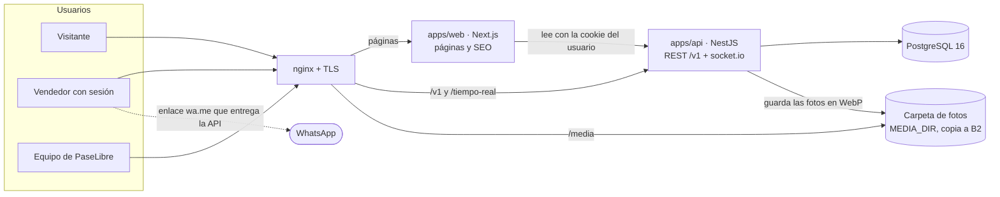
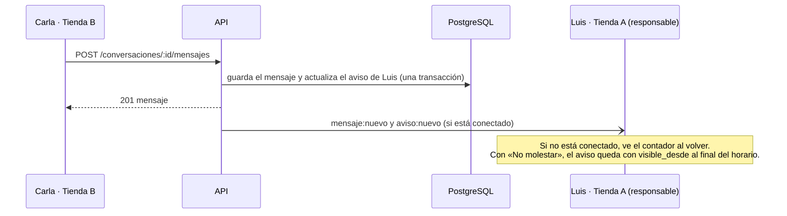

# 05 · Arquitectura

**Versión:** 0.8 (borrador) · **Fecha:** 28/10/2026 · **Responsable:** Dazz

**Decidido el 26/10:** se reutiliza el stack de Yallegó (A-01) y la bandeja de mensajes es **por persona** (A-11). El servidor se elige al final (A-10).

**Desde el 28/10 este documento es el resumen de la arquitectura.** El modelo de datos, la API, la seguridad, los flujos, el design system, el plan y la estructura tienen su propio documento, del [06](06-modelo-de-datos.md) al [12](12-estructura-del-proyecto.md), revisados contra el código. Aquí quedan los principios, las decisiones (A-xx), la vista general, la búsqueda, los mensajes, la infraestructura y los riesgos. Los números de sección se conservan porque el código los cita («docs/05 §9»).

## Cómo leer este documento

Esta es la propuesta técnica para construir la primera salida antes del 31/10. Parte de cuatro fuentes:
- los requerimientos ([02](02-requerimientos-funcionales.md) y [03](03-requerimientos-no-funcionales.md));
- las decisiones del [documento 04](04-decisiones-para-la-reunion.md);
- el **mapa de pantallas y rutas** del [lienzo de diseño](https://claude.ai/artifact/H9iqh18AbknFVzzuRZPK1A), en la página «Línea final · todas las pantallas»;
- el **modelo de productos y ofertas** (D-43).

- **A-xx** son decisiones de arquitectura. Las que dicen *(por confirmar)* esperan el visto bueno de Dazz o del equipo.
- Los nombres de tablas, rutas y campos están en español, igual que la interfaz. El código (clases, funciones) puede ir en inglés si el equipo lo prefiere, pero los contratos de la API usan estos nombres.

---

## 1. Principios

1. **Llegar al 31/10 con lo que ya conocemos.** Se reutiliza el stack y la forma de desplegar de Yallegó, que Dazz ya opera en producción (RNF-35).
2. **El servidor decide qué ve cada quien.** El precio, la tienda, el stand y el WhatsApp nunca salen hacia quien no tiene sesión, aunque la interfaz los esconda (RNF-18, RNF-50, R-15).
3. **Producto y oferta separados desde el primer día.** Es lo único que no se recorta: cambiarlo después obliga a migrar todo el catálogo (D-43, documento 04).
4. **Una sola API para la web y para la futura app.** Las mismas cuentas, los mismos datos y los mismos contratos (RNF-47).
5. **Postgres primero.** No se suma un servicio nuevo (buscador, cola externa, CDN) hasta que un número lo pida (RNF-34).

## 2. Decisiones de arquitectura

| ID | Decisión | Alternativa descartada | Por qué |
| --- | --- | --- | --- |
| A-01 | **Monorepo pnpm** con `apps/web` (Next.js 15), `apps/api` (NestJS 11), `packages/contracts` (Zod), `packages/ui` (tokens y componentes del lienzo) y `packages/config` | Una sola app Next.js con la API dentro | Es la estructura de Yallegó: se copian la configuración, los Dockerfile y los scripts de despliegue. La app del celular reutiliza la API y los contratos sin tocar la web |
| A-02 | **PostgreSQL 16 + Prisma 6**, con las extensiones `pg_trgm`, `unaccent`, `fuzzystrmatch` y `citext` | Meilisearch o Typesense desde el inicio | Con cientos de tiendas y decenas de miles de ofertas (RNF-28), Postgres resuelve la búsqueda tolerante en menos de 1 s. Un buscador aparte es otro servicio que sincronizar y respaldar. Criterio para cambiar en la sección 7 |
| A-03 | **Redis 7** para el adaptador de socket.io, los límites de peticiones y las colas (BullMQ) | Sin Redis | Ya está en el stack. Hace falta para el tiempo real con más de un proceso y para procesar fotos sin frenar la API |
| A-04 | **Tiempo real con socket.io** sobre la misma API, con el adaptador de Redis | Consultar cada pocos segundos (*polling*) | Cumple RNF-48 (menos de 5 s) y ya se usa en Yallegó. Si el socket se cae, la interfaz vuelve a pedir lo pendiente al reconectar |
| A-05 | **Sesión con cookie** `httpOnly` y un token opaco guardado como *hash* en la tabla `sesion`. Contraseñas con **argon2id**. La app usará el mismo token como `Bearer` | JWT sin estado | Suspender una cuenta corta la sesión al instante. Deja lista la lista de sesiones abiertas de la fase 2 (RF-67) |
| A-06 | **Respuestas por audiencia:** cada recurso tiene un contrato para visitante, otro para vendedor y otro para el dueño de la oferta. Las consultas de visitante **no seleccionan** las columnas de precio ni de tienda | Filtrar en la interfaz | Es la única forma de garantizar RNF-18 y RNF-50. Una prueba automática revisa que el JSON público no traiga esos campos |
| A-07 | **WhatsApp a pedido:** el número no viaja en la página. El botón llama a `POST /v1/ofertas/:id/contacto` y la API devuelve el enlace `wa.me` con el mensaje armado | Poner el enlace en el HTML | Protege los números del *scraping* (RNF-19), registra el clic (RF-23) y deja fuera al visitante (RNF-50) |
| A-08 | **Fotos:** se suben a la API, que valida tipo y tamaño, quita los metadatos (EXIF) y genera WebP en 3 tamaños con `sharp`. Se guardan detrás de una interfaz `Almacen`, con disco local en el MVP y copia nocturna a Backblaze B2 | Subir directo a un *bucket* desde el navegador | Menos piezas para el 31/10 y sin costo extra. Pasar a R2 o B2 después es cambiar el adaptador, no el código |
| A-09 | **Next.js renderiza en el servidor** las páginas públicas (portada, búsqueda y ficha) para que los buscadores las indexen (RNF-42). Como nunca llevan datos privados, se pueden cachear. Las páginas con sesión responden `no-store` | Todo en el navegador | SEO, carga rápida en 4G (RNF-10) y ningún riesgo de que una caché sirva un precio a un visitante |
| A-10 | **Docker Compose en un VPS** con nginx, Let's Encrypt, y entornos de *staging* y producción. *Se decide al final si es un VPS nuevo o el de Yallegó*; el mismo `compose.yml` sirve para los dos | Vercel + base administrada | Costo fijo y bajo (RNF-34), el mismo flujo de despliegue que Yallegó y sin límites de WebSocket |
| A-11 | **Bandeja de mensajes por persona.** Cada hilo es entre dos personas: quien escribe y el **responsable** de la oferta, que es quien la publicó. Los demás usuarios de la tienda no lo ven | Bandeja compartida por tienda | Decisión de Dazz (26/10). Cada asesor responde lo suyo. Para que no queden hilos sin dueño, el equipo puede cambiar el responsable de una oferta y de sus hilos (sección 8) |

**Cómo quedaron al construirlas (28/10):**

- **A-01:** `packages/config` se partió en `config-eslint` y `config-typescript`.
- **A-03 y A-04: Redis todavía no se usa.** Con un solo proceso de API alcanzan los límites en memoria y la presencia en memoria, y no hay colas. Redis sigue en el entorno de desarrollo, pero no se despliega (sección 10). Se suma con el adaptador de socket.io cuando haga falta más de un proceso, o con la cola cuando llegue el aviso por correo.
- **A-08: las fotos se procesan en la misma petición,** sin cola: una sola versión WebP de 1600 px como máximo, sin EXIF, en la carpeta `MEDIA_DIR` que nginx sirve en `/media`. No hay interfaz `Almacen`. La copia a B2 la hace el respaldo nocturno con `rclone` ([RESPALDOS.md](../tools/deploy/RESPALDOS.md)).

## 3. Vista general

| Pieza | Qué hace | Qué no hace |
| --- | --- | --- |
| **nginx** | TLS, compresión, sirve `/media` con caché larga, pasa `/v1` y el WebSocket a la API y el resto a la web | No guarda en caché nada con cookie de sesión |
| **Web (Next.js)** | Pantallas del lienzo, SEO, formularios. En el servidor llama a la API con la cookie del usuario | No habla con la base de datos ni decide permisos |
| **API (NestJS)** | Reglas de negocio, permisos, contratos por audiencia, búsqueda, chat en tiempo real y avisos | No arma HTML |
| **PostgreSQL** | Datos, búsqueda tolerante y métricas de uso | |
| **Carpeta de fotos** | Las fotos ya procesadas, que nginx entrega sin pasar por la API | No guarda originales: cada foto se vuelve a codificar al subirla |
| **Redis y cola** *(previstos, A-03)* | Todavía no se usan | Se suman al pasar a más de un proceso de API o al llegar el aviso por correo |

## 4. Modelo de datos

El detalle completo, revisado contra el esquema, está en el **[documento 06 · Modelo de datos](06-modelo-de-datos.md)**.

### 4.1 La idea central: producto y oferta

Un **producto** es el modelo que existe en el mercado, una sola vez en el catálogo; una **oferta** es lo que una tienda tiene de ese producto (condición, stock, precio, moneda y si el precio se ve). «Publicar uno igual» crea una oferta sobre un producto existente. Es lo único que no se recorta (D-43). Diagrama en el [documento 06 §1](06-modelo-de-datos.md#1-la-idea-central-producto-y-oferta).

### 4.2 Tablas de la primera salida

Las 27 tablas, con sus columnas clave: [documento 06 §2](06-modelo-de-datos.md#2-tablas).

### 4.3 Reglas que cuida la base de datos

Dinero en céntimos enteros, stock nunca negativo, una oferta vigente por producto, tienda y condición, borrar sin borrar y «Vendido» que resta exactamente uno: [documento 06 §3](06-modelo-de-datos.md#3-reglas-que-cuida-la-base).

## 5. Quién ve qué

El visitante ve el producto, la condición, el stock, la galería y la fecha, pero **nunca** el precio, la tienda, el stand ni el WhatsApp: el servidor no se los manda (A-06) y una prueba lo vigila. La tabla completa y cómo se garantiza, en el [documento 08 §2](08-seguridad-y-autenticacion.md#2-quién-ve-qué).

## 6. Rutas de la web y de la API

Las rutas pasaron a sus propios documentos, revisadas contra el código.

### 6.1 Rutas de la web (las del mapa del lienzo)

Las pantallas, quién entra a cada una y los recorridos: [documento 09 · UX y flujos](09-ux-y-flujos.md#2-mapa-de-pantallas).

### 6.2 API `/v1`

Todas las rutas, los errores y lo que todavía no está construido (carga por planilla y unir duplicados): [documento 07 §2](07-contrato-de-la-api.md#2-rutas).

### 6.3 Tiempo real

El socket en `/tiempo-real`, sus salas y sus eventos: [documento 07 §3](07-contrato-de-la-api.md#3-tiempo-real).

## 7. Búsqueda tolerante a errores

**Objetivo:** «rtx 3370» encuentra la RTX 3070 y lo dice (RF-13, RF-14) en menos de 1 s (RNF-08).

1. **Normalizar** la consulta: minúsculas, sin tildes, separar letras de números («rtx3070» → «rtx 3070»), espacios simples. Las etiquetas y `producto.texto_busqueda` se guardan con la misma normalización.
2. **Buscar tal cual:** productos cuyo `texto_busqueda` contiene todas las palabras. Usa un índice GIN `gin_trgm_ops`.
3. **Si hay pocos resultados, corregir palabra por palabra** contra la tabla `termino`, que tiene las palabras conocidas del catálogo:
   - Para las palabras con números se usa la distancia de Levenshtein (`fuzzystrmatch`) con tope 1: «3370» → «3070». La similitud por trigramas falla con números cortos.
   - Para las palabras con letras se usa `similarity()` de `pg_trgm` con un mínimo de 0,4: «ventsu» → «ventus».
4. **Volver a buscar** con la consulta corregida y responder `{ "correccion": { "buscaste": "rtx 3370", "mostramos": "rtx 3070" } }`.
5. **Agrupar por producto:** cuántas ofertas tiene, en qué galerías, stock total, si hay nuevos o usados y, solo con sesión, el menor precio visible.
6. **Facetas** (galería, marca, condición, stock) con conteos, y **ordenar** por más recientes o por precio. El orden por precio solo se ofrece con sesión.
   - **Monedas:** no hay tipo de cambio, así que no se mezclan. El orden por precio va primero por el menor precio visible en dólares y después en soles.
   - **Filtro de precio:** se aplica a los precios visibles en la moneda elegida. Las ofertas al interno siempre se muestran, como dice el lienzo.
7. **Registrar** la búsqueda en `busqueda`, incluidas las que no tuvieron resultados (RF-32).

**Cuándo pasar a un buscador dedicado:** si con más de 50 000 ofertas la búsqueda supera 1 s en el 95 % de los casos, o si hacen falta sinónimos y orden por relevancia más finos. Entonces se suma Meilisearch, alimentado desde la cola, sin cambiar el contrato de `/v1/buscar`.

## 8. Mensajes, «Vendido» y campanita

- **Un hilo por oferta y por persona que pregunta.** «Enviar mensaje» desde la ficha abre el hilo existente o crea uno nuevo con el responsable de la oferta, con el producto fijo arriba.
- **Bandeja por persona (A-11).** El hilo es entre quien escribe y el responsable de la oferta. El dueño no ve los hilos de sus asesores ni al revés.
- **Hilos sin dueño:** si un asesor deja la tienda o su cuenta se suspende, el equipo pasa sus publicaciones y sus hilos a otra cuenta activa de la misma tienda (`POST /equipo/cuentas/:id/traspasar`), en una transacción y con registro en `auditoria`. En la fase 2 lo hará el dueño desde Mis publicaciones.
  - Pasan las publicaciones no eliminadas y los hilos donde era el vendedor, con su estado de lectura y su aviso de la campanita.
  - Los hilos donde preguntó como comprador también pasan, salvo que la cuenta que recibe ya tenga uno por la misma publicación (un hilo por publicación y persona). Esos quedan donde estaban y el panel lo avisa.
  - Los bloqueos son de la persona: no se traspasan.
- **Bloqueo:** quien bloquea, bloquea a la tienda entera. Antes de guardar un mensaje, la API revisa la tabla `bloqueo`; el bloqueado recibe el error `BLOQUEADO` y no se le avisa al otro.
- **Fotos en el chat:** se suben con `POST /archivos` y el mensaje lleva la referencia. Una foto por mensaje (con texto opcional) y nada de archivos (D-30).
- **La lista** solo muestra hilos con al menos un mensaje: abrir el chat desde la ficha y no escribir no le llena la bandeja a nadie. Un mensaje nuevo saca el hilo de Archivados.
- **La campanita** tiene un aviso por conversación: «Tienes 2 mensajes sin leer de Tienda C», con el último mensaje como extracto. Si el hilo está silenciado o la persona apagó los avisos de mensajes no hay aviso, pero el chat se actualiza igual. Con «No molestar» (hora de Lima, también de noche a la mañana), el aviso aparece al terminar el horario.
- **Desde la ficha:** «Enviar mensaje» es un enlace a `/mensajes?oferta=<id>`, que abre el hilo y lleva a él.

**«Vendido» (RF-47):** se hace en una sola transacción.
1. Se bloquea la fila de la oferta.
2. Se valida que `stock > 0`.
3. Se resta 1 y se inserta la `venta` con el stock antes y después.
4. Se agrega un mensaje `SISTEMA` al hilo («1 unidad vendida a Tienda B · stock 2 → 1») y se emite `oferta:stock`.

Solo se vende a alguien que escribió por esa oferta en un hilo de quien vende.

Así, dos «Vendido» al mismo tiempo no dejan el stock en negativo. Si se recorta (documento 04, recorte 1), el vendedor usa el − de Mis publicaciones, que llama al mismo `PATCH`.

**Privacidad (RNF-44):** el panel del equipo no tiene ninguna ruta para leer conversaciones. Una denuncia guarda el motivo y el identificador del hilo; si el equipo necesita ver mensajes, se los pide a quien denunció.

## 9. Cuentas, sesiones y seguridad

Roles, ingreso con argon2id, sesión con cookie y token opaco, cabecera `X-PaseLibre` contra CSRF, límites por IP y por persona, fotos sin EXIF y lo que falta (términos, consentimiento, borrar una cuenta, CSP en la web): **[documento 08 · Seguridad y autenticación](08-seguridad-y-autenticacion.md)**.

## 10. Infraestructura, despliegue y operación

- **Servicios** (un `tools/deploy/compose.yml` que se parametriza por entorno): `web`, `api`, `migrate` (corre y termina) y `postgres:16-alpine`. nginx del host con Let's Encrypt. Las fotos van en una carpeta del servidor que la API escribe y nginx sirve en `/media`. Redis no se despliega todavía: la API no lo usa (no hay cola de tareas ni más de un proceso); se agrega cuando haga falta.
- **Entornos:** *staging* y producción, con bases separadas (RNF-33). El despliegue sigue el patrón de Yallegó:
  1. Construir las imágenes.
  2. Respaldar la base.
  3. Correr las migraciones.
  4. Cambiar las imágenes en el archivo de entorno (`IMAGEN_TAG`).
  5. Hacer una prueba de humo.

  Todo eso lo hace `tools/deploy/scripts/desplegar.sh`; cómo se prepara el servidor y se usa, en [`tools/deploy/DESPLIEGUE.md`](../tools/deploy/DESPLIEGUE.md).
- **Respaldos (RNF-13):** ver [`tools/deploy/RESPALDOS.md`](../tools/deploy/RESPALDOS.md).
  - `pg_dump` cada noche, con 7 diarios y 4 semanales, validado antes de publicarse.
  - Los respaldos y las fotos se copian a B2 con `rclone`.
  - Los domingos, un ensayo restaura el último respaldo en una base aparte, lo compara y revisa que existan las fotos.
  - Antes de salir se prueba una restauración completa en *staging*.
- **Observabilidad (RNF-38, RNF-39):**
  - Logs JSON con pino.
  - `GET /v1/salud`, revisada desde afuera cada minuto por un monitor gratuito que avisa por correo.
  - Los reportes de uso (RF-31) son consultas SQL sobre `busqueda`, `contacto` y `oferta`.
- **Costo (RNF-34):** un VPS de 2 vCPU y 4 GB alcanza para la primera salida. El costo mensual es del orden de un VPS chico más centavos de B2; el dominio va aparte *(por confirmar: VPS y dominio)*.

## 11. Estructura del código y reparto

Las carpetas del monorepo, los módulos de la API, las pantallas de la web, dónde va cada cosa nueva y los comandos: **[documento 12 · Estructura del proyecto](12-estructura-del-proyecto.md)**.

## 12. Plan de construcción al 31/10

El plan día por día, cómo va y lo que queda hasta el sábado: **[documento 11 · Plan de desarrollo](11-plan-de-desarrollo.md)**. Al 28/10 el código de los días 1 al 5 está hecho y el plan B no hace falta; *staging* está atrasado porque espera el VPS y el dominio ([documento 11 §2](11-plan-de-desarrollo.md#2-cómo-va-2810)).

## 13. Pruebas (RNF-32)

Qué pruebas hay, qué corre la CI y qué falta: [documento 11 §4](11-plan-de-desarrollo.md#4-pruebas-rnf-32).

## 14. Decisiones pendientes

| # | Decisión | Recomendación |
| --- | --- | --- |
| 1 | **Dónde corre:** un VPS nuevo o el mismo de Yallegó. Dazz lo decide al final | Un VPS nuevo y chico: Yallegó maneja pagos y conviene no compartir máquina con un sitio público nuevo. Si se usa el mismo, va con su propio `compose`, su propia base y su propio usuario de sistema |
| 2 | **Dominio** | Comprarlo esta semana; *staging* puede vivir en un subdominio provisional |
| 3 | **Maquetación de Grimm:** si es código (React, HTML) o solo una imagen o un diseño | Preguntárselo a Grimm. Si es código React, sus piezas se reutilizan; si es HTML o un diseño, sirve de referencia y se construye con la línea del lienzo |

## 15. Riesgos técnicos

| ID | Riesgo | Mitigación |
| --- | --- | --- |
| RT-01 | Una caché sirve a un visitante una página con precio | Las páginas con sesión responden `no-store`, nginx no cachea con cookie y hay una prueba de contrato público (sección 5) |
| RT-02 | El WebSocket no pasa por nginx o se corta en redes móviles | Configuración de `upgrade` probada en *staging* el 29/10; al reconectar se recupera lo pendiente (sección 6.3) |
| RT-03 | Con pocos productos, la corrección sugiere palabras equivocadas | `termino` se arma solo con el catálogo real y el tope de distancia es 1; las búsquedas sin resultados se revisan cada semana |
| RT-04 | Los duplicados crecen más rápido de lo que el equipo une | La sugerencia al publicar usa la misma búsqueda tolerante, y el panel lista los posibles duplicados por similitud |
| RT-05 | Un solo VPS es un punto único de falla | Respaldos diarios con restauración probada y un monitor externo. Con el piloto, la meta es el 99 % (RNF-12) |
| RT-06 | El plazo: seis días para cuatro personas | Plan día por día, recortes del documento 04 y plan B el 29/10 |
