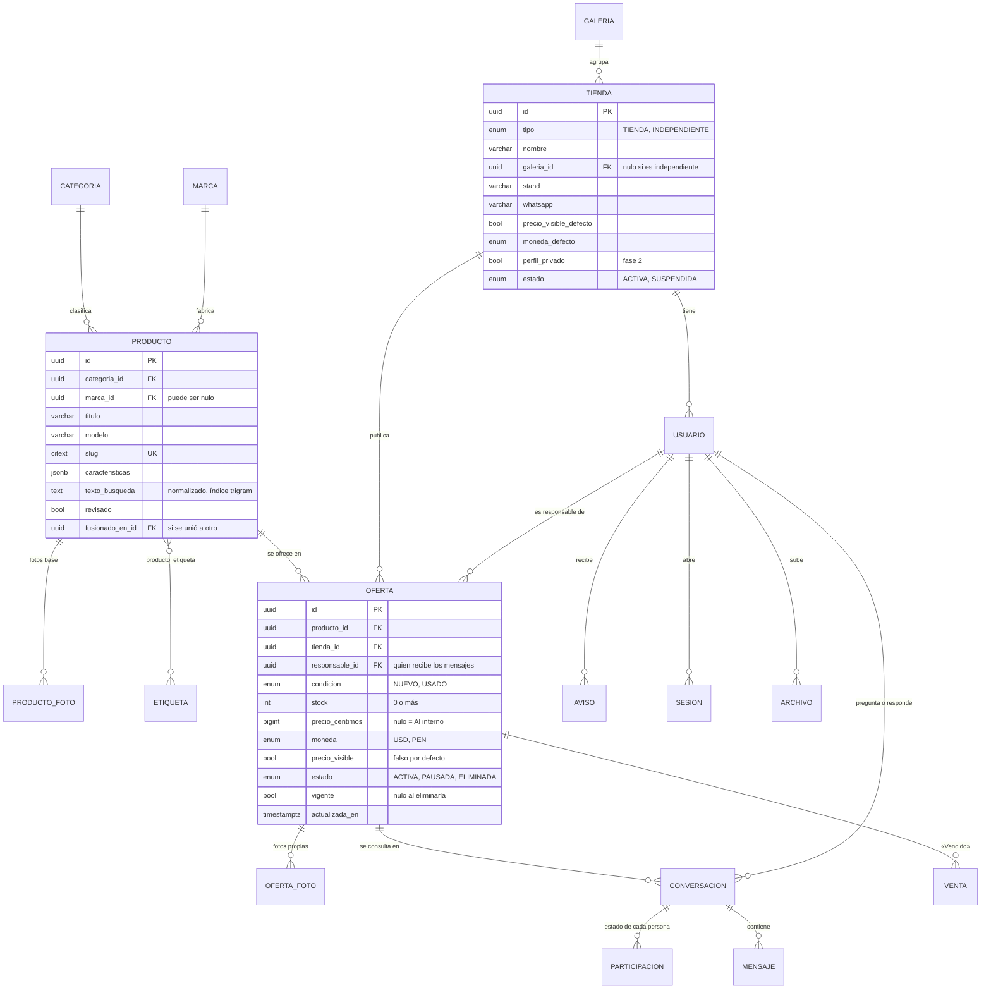

# 06 · Modelo de datos

**Versión:** 0.1 · **Fecha:** 28/10/2026 · **Responsable:** Dazz

Las tablas de la base, qué guarda cada una y las reglas que cuida la propia base. Sale de la sección 4 del [documento 05](05-arquitectura.md#4-modelo-de-datos), revisada contra el código.

**La fuente de verdad es el esquema:** [`apps/api/prisma/schema.prisma`](../apps/api/prisma/schema.prisma) y sus migraciones en [`apps/api/prisma/migrations`](../apps/api/prisma/migrations). Si este documento y el esquema no coinciden, manda el esquema y se corrige el documento.

- Postgres 16 con las extensiones `citext`, `pg_trgm`, `unaccent`, `fuzzystrmatch` y `pgcrypto`.
- Las tablas y columnas van en español y en `snake_case` (en Prisma, en `camelCase` con `@map`).
- Los identificadores son UUID generados por la base (`gen_random_uuid()`).
- Las fechas son `timestamptz`.

---

## 1. La idea central: producto y oferta

- Un **producto** es el modelo que existe en el mercado, una sola vez en el catálogo. Por ejemplo, «MSI GeForce RTX 3070 Ventus 3X OC 8 GB», con su categoría, marca, fotos base, etiquetas y características.
- Una **oferta** es lo que una tienda tiene de ese producto: condición (nuevo o usado), stock, precio, moneda, si el precio es visible y una descripción propia. La ficha del producto lista sus ofertas.
- **«Publicar uno igual»** crea una oferta sobre un producto que ya existe; no copia el producto.
- Un **producto nuevo** lo crea el vendedor cuando no lo encuentra, en el mismo paso que su oferta. Queda con `revisado = false` hasta que el equipo confirme que no está repetido.

Es la decisión que más pesa (D-43) y la única que no se recorta: cambiarla después obliga a migrar todo el catálogo.

## 2. Tablas

### 2.1 Cuentas

| Tabla | Para qué | Columnas clave |
| --- | --- | --- |
| `galeria` | Maxiplaza, Cyberplaza y las que vengan. Es un dato, no una constante (RNF-29) | `nombre` y `slug` únicos, `activa`, `orden` |
| `tienda` | Quien vende: una tienda de galería o un independiente | `tipo`, `nombre`, `galeria_id`, `stand`, `whatsapp`, `horario`, `descripcion`, `logo`, `precio_visible_defecto` (falso), `moneda_defecto` (USD), `perfil_privado` (fase 2, ya creada), `estado` |
| `usuario` | Las personas que entran | `tienda_id` (nulo solo para el equipo), `rol` (DUENO, ASESOR, EQUIPO), `usuario` y `correo` (citext únicos; el correo es opcional), `nombre`, `whatsapp`, `clave_hash` (argon2id), `debe_cambiar_clave`, `primer_ingreso_en`, `estado` (ACTIVO, SUSPENDIDO), `intentos_fallidos`, `intentos_desde`, `bloqueado_hasta`, `ultimo_ingreso_en`, `ultima_conexion_en` (para «Activo hace 2 h»), `no_molestar_desde` y `no_molestar_hasta` (minutos desde la medianoche, hora de Lima), `mostrar_visto` |
| `sesion` | Sesiones abiertas (A-05) | `usuario_id`, `token_hash` (SHA-256 del token, único), `recordar`, `creada_en`, `usada_en`, `expira_en`, `revocada_en`, `agente`, `ip` |

### 2.2 Catálogo

| Tabla | Para qué | Columnas clave |
| --- | --- | --- |
| `categoria` | Las 7 categorías iniciales (RF-11), ampliables sin tocar código | `nombre`, `slug` único, `orden`, `padre_id` (subcategorías) |
| `marca` | El filtro por marca | `nombre` y `slug` únicos |
| `producto` | El catálogo único (ver el diagrama) | `texto_busqueda` lo arma la API con `normalizarTexto` a partir del título, la marca, el modelo y las etiquetas. `creado_por_tienda_id` dice quién lo creó |
| `producto_foto` | Fotos base del producto | `ruta`, `orden`, `ancho`, `alto` |
| `etiqueta` | Etiquetas (RF-07) | `nombre` y `clave` normalizada única: «RTX3070», «rtx 3070» y «RTX-3070» dan la clave `rtx 3070` (RNF-26) |
| `producto_etiqueta` | Etiquetas de cada producto | Clave (`producto_id`, `etiqueta_id`) |
| `oferta` | Lo que publica cada tienda (ver el diagrama) | `responsable_id` es quien la publicó y quien recibe sus mensajes (A-11). Única por producto, tienda y condición mientras esté vigente |
| `oferta_foto` | Fotos propias de la oferta, opcionales | Hasta 8 por oferta |
| `termino` | Las palabras que existen en el catálogo, para corregir «3370» → «3070» | `palabra` (ya normalizada), `veces`. Índice trigram |
| `archivo` | Fotos subidas que todavía no se usan | `usuario_id`, `tienda_id`, `ruta` única, `ancho`, `alto`, `bytes`, `usado_en`. Una foto la usa solo alguien de la misma tienda, y una sola vez |

### 2.3 Mensajes y avisos

| Tabla | Para qué | Columnas clave |
| --- | --- | --- |
| `conversacion` | Un hilo por oferta y por persona que pregunta | `oferta_id`, `comprador_id`, `vendedor_id`, `tienda_compradora_id`, `tienda_vendedora_id`, `ultimo_mensaje_en`. Única por (`oferta_id`, `comprador_id`) |
| `participacion` | El estado de cada persona en el hilo | `archivada`, `silenciada`, `no_leida_manual`, `leido_hasta` (para el «Visto») |
| `mensaje` | Texto, foto o aviso del sistema | `autor_id` (nulo en los del sistema), `tipo` (TEXTO, FOTO, SISTEMA), `texto` (hasta 2000), `foto` |
| `respuesta_rapida` | Las de Configuración (RF-56) | `usuario_id`, `texto` (hasta 120), `orden` |
| `bloqueo` | Quién bloqueó a quién (RF-57) | `usuario_id` (quien bloquea) y `tienda_bloqueada_id`: se bloquea a la tienda entera |
| `denuncia` | Para moderación (RNF-53) | `denunciante_id`, `objeto` (OFERTA, CONVERSACION, TIENDA), `objeto_id`, `motivo`, `estado` (ABIERTA, REVISADA, DESCARTADA) |
| `venta` | Cada «Vendido» (RF-47) | `oferta_id`, `comprador_id`, `tienda_compradora_id`, `conversacion_id`, `stock_antes`, `stock_despues`, `registrada_por_id` |
| `aviso` | La campanita (RF-40) | `usuario_id`, `tipo` (MENSAJE, SEGURIDAD, RECORDATORIO, SISTEMA), `titulo`, `extracto`, `enlace`, `conversacion_id`, `visible_desde` (para «No molestar»), `leido_en`. Uno por persona y conversación: se actualiza, no se apila |
| `preferencia_aviso` | Configuración · Avisos (RF-59) | `usuario_id`, `tipo`, `campanita`. La columna del correo llega con RF-42 |

### 2.4 Métricas y operación

| Tabla | Para qué | Columnas clave |
| --- | --- | --- |
| `busqueda` | Métricas, búsquedas sin resultados y «Lo más buscado» del buscador (RF-31, RF-32). Las sugerencias mientras se escribe no se guardan | `texto`, `texto_corregido`, `resultados`, `usuario_id`, `creada_en` |
| `contacto` | Clics en «Enviar mensaje» y «WhatsApp» (RF-23) | `oferta_id`, `usuario_id`, `canal` (CHAT, WHATSAPP), `creado_en` |
| `auditoria` | Acciones del equipo: crear cuenta, nueva clave, suspender, traspasar, unir productos | `actor_id`, `accion`, `objeto`, `objeto_id`, `datos` |
| `carga_planilla` | Carga por planilla con vista previa (RF-34) | `tienda_id`, `creada_por_id`, `archivo`, `filas`, `estado` (BORRADOR, CARGADA, DESCARTADA). **La tabla existe, pero la carga pasó a la fase 2:** nada la usa todavía |

## 3. Reglas que cuida la base

Están como `CHECK` o índices únicos en la [migración inicial](../apps/api/prisma/migrations/20261027025856_inicial/migration.sql), así que valen aunque la API se equivoque.

- **Dinero en enteros:** `precio_centimos` (US$ 250 → 25000) y `moneda`, nunca decimales. No puede ser negativo. Sin precio, la web muestra «Al interno».
- **Precio visible solo con precio:** una oferta no puede tener `precio_visible` sin `precio_centimos`.
- **Stock nunca negativo** (`stock >= 0`). «Sin stock» se deriva de `stock = 0`: no es un estado.
- **Una oferta vigente por producto, tienda y condición.** `vigente` vale `true` mientras la oferta no está eliminada y nulo cuando lo está. El índice único incluye `vigente`, así que puede haber muchas eliminadas pero una sola vigente. Un `CHECK` ata `vigente` a `estado`.
- **Borrar no borra:** eliminar una oferta es `estado = ELIMINADA`, para conservar sus conversaciones y ventas.
- **El equipo no tiene tienda:** `rol = EQUIPO` si y solo si `tienda_id` es nulo.
- **Una tienda de galería tiene galería:** solo el independiente puede tener `galeria_id` nulo.
- **No se conversa con uno mismo:** `comprador_id` distinto de `vendedor_id`.
- **«Vendido» resta exactamente uno:** `stock_antes > 0` y `stock_despues = stock_antes - 1`.
- **«No molestar» completo o vacío:** las dos horas, o ninguna.
- **Un mensaje tiene contenido:** uno de tipo FOTO lleva foto; los demás llevan texto.

Y estas las cuida la API:

- **`actualizada_en`** cambia con stock, precio, visibilidad o «Siguen igual». De ahí salen la fecha de la ficha (RF-09) y el aviso de los 7 días (RF-10).
- **Valores por defecto de la tienda:** al publicar, la oferta toma `precio_visible_defecto` y `moneda_defecto`; el vendedor puede cambiarlos (D-37).
- **Unir productos** (RF-54) mueve las ofertas al producto que se queda y marca el otro con `fusionado_en_id`; su dirección vieja redirige con 301. **La redirección ya funciona; la acción de unir todavía no existe** (ver el [checklist](CHECKLIST.md)).
- **«Vendido»** se hace en una transacción que bloquea la fila de la oferta, para que dos ventas a la vez no dejen el stock en negativo ([documento 05 §8](05-arquitectura.md#8-mensajes-vendido-y-campanita)).

## 4. Índices

| Índice | Para qué |
| --- | --- |
| GIN trigram en `producto.texto_busqueda` | La búsqueda tolerante a errores ([documento 05 §7](05-arquitectura.md#7-búsqueda-tolerante-a-errores)) |
| GIN trigram en `termino.palabra` | La corrección palabra por palabra |
| `oferta (producto_id, estado)` y `(tienda_id, estado)` | La ficha y Mis publicaciones |
| `conversacion (comprador_id, ultimo_mensaje_en)` y `(vendedor_id, ultimo_mensaje_en)` | La bandeja de cada persona, la más reciente arriba |
| `mensaje (conversacion_id, creado_en)` | El historial por páginas |
| `aviso (usuario_id, leido_en, visible_desde)` | La campanita y su contador |
| `denuncia (estado, creada_en)` | La cola de denuncias abiertas |

## 5. Migraciones

| Migración | Qué hizo |
| --- | --- |
| `20261027025856_inicial` | Extensiones, todas las tablas, los `CHECK` y los índices |
| `20261027032701_medidas_de_fotos_de_oferta` | `ancho` y `alto` en las fotos de la oferta |
| `20261027132605_archivos_subidos` | La tabla `archivo`, para las fotos subidas antes de usarse |
| `20261028004357_ultima_conexion` | `usuario.ultima_conexion_en`, para «Activo hace 2 h» |

**Cómo se cambia el modelo:**

1. Se edita `schema.prisma` y se crea la migración en local con `pnpm db:migrate`.
2. **Las migraciones solo avanzan y agregan.** Cada una tiene que funcionar con la versión anterior del código, porque revertir las imágenes no deshace una migración ([DESPLIEGUE.md](../tools/deploy/DESPLIEGUE.md#5-despliegues-siguientes)).
3. En el servidor las aplica `desplegar.sh`, después de respaldar la base.

## 6. Fase 2 prevista

Se agregan con migraciones nuevas, sin tocar las tablas de arriba: `pedido_pase`, `pregunta`, `favorito`, `seguimiento` y `precio_rol`. `tienda.perfil_privado` y `carga_planilla` ya existen y esperan su pantalla.
