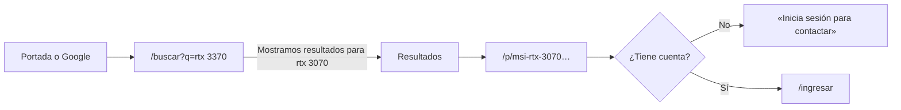
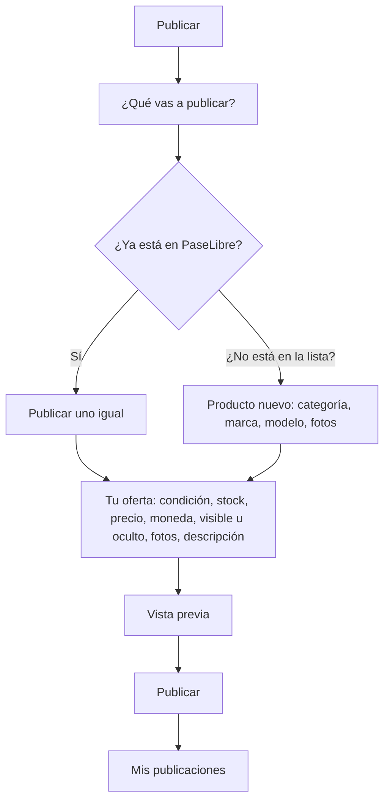
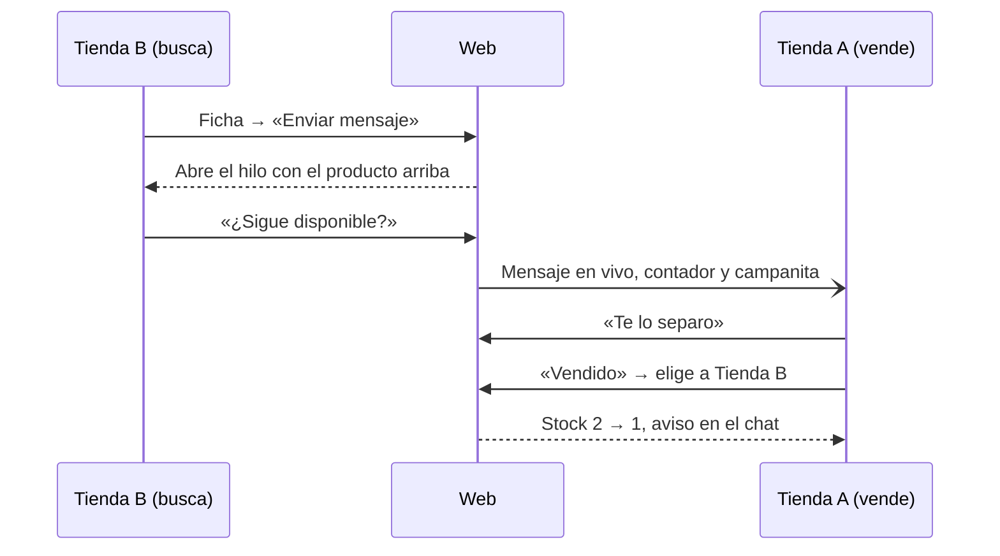

# 09 · UX y flujos

**Versión:** 0.1 · **Fecha:** 28/10/2026 · **Responsable:** Dazz, para revisar con Grimm y My

Las pantallas de la web, cómo se llega a cada una y los recorridos principales, tal como están construidos. La referencia visual es el [lienzo de diseño](https://claude.ai/artifact/H9iqh18AbknFVzzuRZPK1A), página «Línea final · todas las pantallas»; los nombres entre paréntesis (F_Portada, C_Mensajes…) son sus pantallas. La línea gráfica está en el [documento 10](10-design-system.md) y las rutas de la API en el [documento 07](07-contrato-de-la-api.md).

**El lienzo y la web ya no coinciden en la línea gráfica:** el lienzo sigue en Inter y lima, y la web está en Hielo (Figtree y azul). La estructura de las pantallas sí es la del lienzo.

---

## 1. Para quién es cada pantalla

| Persona | Qué busca | Por dónde entra |
| --- | --- | --- |
| **Visitante** (cualquiera, sin sesión) | Saber si alguien en Wilson tiene un producto | Google, un enlace compartido o la portada |
| **Vendedor** (dueño, asesor o independiente con cuenta) | Encontrar un pase, publicar lo suyo y responder mensajes | `/ingresar` con la cuenta que le dio el equipo |
| **Equipo de PaseLibre** | Dar de alta a las tiendas y resolver problemas de cuentas | `/ingresar`, y de ahí a su panel |

## 2. Mapa de pantallas

| Ruta | Pantalla (lienzo) | Quién | Notas |
| --- | --- | --- | --- |
| `/` | Portada (F_Portada) | Todos | Buscador, categorías y «Recién publicado». Con sesión, la barra es la de la tienda y aparecen los precios |
| `/buscar?q=…` | Resultados (F_Resultados) | Todos | Filtros, orden y página viven en la dirección: una búsqueda se comparte y funciona sin JavaScript. La categoría también va como filtro (`?categoria=`) |
| `/p/:producto` (y `?oferta=:id`) | Ficha (F_Ficha) | Todos | Fotos, datos, ofertas de las tiendas, «Enviar mensaje», «WhatsApp» y «Publicar uno igual». Un producto unido a otro redirige con 301 |
| `/ingresar` | Acceso y primer ingreso (F_Acceso) | Sin sesión | Si ya hay sesión, lleva a la portada (o al panel, si es del equipo) |
| `/publicar` (`?igual=`, `?editar=`) | Publicar uno igual (F_Publicar) | Vendedor | Publicar, publicar uno igual desde la ficha y editar |
| `/mis-publicaciones` | Mis publicaciones (F_MisPublicaciones) | Vendedor | |
| `/mensajes` y `/mensajes/:id` | Mensajes (C_Mensajes, F_MovilChat) | Vendedor | En el celular, la lista y el chat son dos pantallas |
| `/cuenta/configuracion` (`?seccion=`) | Configuración (C_Configuración) | Vendedor | |
| `/equipo/cuentas` | Panel del equipo (F_Equipo) | Equipo | `/equipo` lleva aquí |
| `/ayuda`, `/terminos`, `/privacidad` | — (C_Footer) | Todos | Ayuda con preguntas frecuentes, y los borradores de Términos y Privacidad |
| `/sitemap.xml`, `/robots.txt` | — | Buscadores | Solo producción se deja indexar |
| `/salud` | — | — | Solo para el *healthcheck* del servidor |

**Del mapa del lienzo que no se construyó:** `/c/:categoria` (se usa `/buscar?categoria=`), `/equipo/carga` (carga por planilla, fase 2) y `/equipo/catalogo` (unir duplicados, pendiente). Las rutas de la fase 2 (`/cuenta`, `/t/:tienda`, `/notificaciones`, `/bandeja`) siguen reservadas para no chocar después.

**Barras y pie:**

- **Una sola barra, la de C_Header** (28/10), igual con sesión y sin ella, en el catálogo y en las páginas del vendedor (`shared/ui/cabecera.tsx`). De arriba abajo:
  1. **Fila del saludo** (desde tablet): «¡Hola! Inicia sesión o pide tu cuenta» o «¡Hola, Tienda B!», «Cómo funciona» y «Ayuda y contacto»; a la derecha, el selector de **galería** y «Publicar» (y «Mi cuenta» sin sesión). La galería filtra lo recién publicado en la portada y, desde cualquier otra página, lleva a los resultados de esa galería.
  2. **Logo con «Pases entre tiendas de Wilson»**, el **buscador** (texto, selector de categoría desde tablet y «Buscar» aparte) y, con tienda, la campanita, Mensajes con su contador y «Mi cuenta» (Publicar, Configuración, Mis publicaciones, Mensajes y Cerrar sesión). Sin sesión, en el celular, «Ingresar».
  3. **Banda de categorías en azul noche:** «Todas las categorías», cada categoría y, a la derecha, «Soporte por WhatsApp» (cuando exista el número) o «Ayuda y soporte». En el celular se desliza de lado.
  4. **Franja de ventajas en azul suave** (desde tablet): «Pases entre tiendas de Wilson · Gratis para el piloto · Precios solo con sesión · Busca aunque escribas mal · Chat y WhatsApp · El trato es entre vendedores».
- **En Mensajes** la barra va sin banda ni franja, para que el chat entre en la pantalla.
- **En el celular** queda como F_MovilPortada: logo con los iconos, buscador y banda.
- **«Comprar por categoría»** (desde computadora, junto al logo): abre un panel a todo el ancho con las categorías a la izquierda y, para la que se señala, sus marcas, su estado y sus galerías con cuántas ofertas hay de cada una, más «Ver todo en …».
- **El desplegable del buscador:**
  - Con el campo vacío: las **búsquedas recientes** (se guardan en el navegador, hasta 5, y cada una se quita con ×) y **«Lo más buscado»** (lo que se buscó al menos dos veces en 30 días y encontró algo).
  - Mientras se escribe: **«¿Quisiste decir…?»** cuando corrige, hasta **5 productos** con su foto o ícono, categoría, ofertas y galerías, y al final «Ver los N resultados» o «Buscar «…»».
  - Se maneja con las flechas, Enter y Escape. Lo que se va escribiendo no cuenta como búsqueda en las métricas.
- **Fuera, a propósito:** «Avanzada» (los filtros están en `/buscar`).
- **Equipo:** su propia barra oscura, con el logo y su panel.
- **Pie:** el claro con columnas del lienzo (C_Footer, elegido el 28/10): la marca, las columnas PaseLibre, Ayuda y Legal, y «El trato es entre vendedores: PaseLibre no interviene en las ventas». Mensajes y el panel del equipo llevan el compacto (C_FooterCompacto), para no ponerle un pie alto al chat. «Escríbenos por WhatsApp» aparece cuando exista el número, y «Libro de Reclamaciones» sigue sin enlace hasta decidir si aplica ([checklist](CHECKLIST.md)).

**Quién entra a qué:**

- Sin sesión, las pantallas del vendedor llevan a `/ingresar`.
- Con la clave temporal, toda pantalla lleva a `/ingresar` hasta crear la contraseña propia.
- Una cuenta del equipo no tiene tienda: las pantallas del vendedor la llevan a su panel.

## 3. Flujos

### 3.1 El visitante busca un producto

1. Busca como escribe: «rtx3370», «Ventsu». La búsqueda corrige y lo dice: «Mostramos resultados para *rtx 3070*. Buscaste *rtx 3370*» (RF-13, RF-14).
2. Filtra por categoría, galería, marca, condición y «Con stock» (RF-16, RF-17).
3. En la ficha ve fotos, condición, stock, galería y fecha de actualización. **No ve precio, tienda, stand ni WhatsApp** (D-34): ve «Precio con sesión» y «Tienda de Maxiplaza».
4. En lugar de los botones de contacto ve «Inicia sesión para contactar». Como no hay registro propio, «Crear cuenta» avisa que está en mantenimiento y ofrece pedir la cuenta por WhatsApp al equipo (RF-43).

### 3.2 Primer ingreso

1. El equipo crea la cuenta y le pasa a la persona su usuario y una clave temporal ([3.7](#37-el-equipo-da-de-alta-una-tienda)).
2. En `/ingresar` escribe usuario o correo y la clave. «Mantener la sesión en este equipo» la deja abierta 30 días.
3. Como la clave es temporal, aparece «Crea tu contraseña»: 8 caracteres y un número como mínimo.
4. Entra a la portada, ya con precios y tiendas.

**¿Olvidaste tu contraseña?** abre WhatsApp con el equipo, que le da una clave temporal nueva (RF-50). Los enlaces al WhatsApp del equipo solo aparecen cuando existe el número de PaseLibre: hoy no existe, así que no se ven.

### 3.3 Publicar

1. Escribe el producto y la lista «Ya está en PaseLibre» le sugiere los parecidos, con la misma búsqueda tolerante (RF-53).
2. Si está, elige **«Publicar uno igual»**: no se crea otro producto, solo su oferta. Si no está, «¿No está en la lista?» abre el producto nuevo.
3. Completa su oferta. El precio sale **oculto** y en dólares por defecto, o con lo que la tienda fijó en Configuración · Preferencias (RF-48).
4. Ve la vista previa y publica. Meta: menos de 2 minutos (RNF-03).

**Atajos:** «Publicar uno igual» desde la ficha de otro (`/publicar?igual=`) llega con el producto ya elegido; «Editar» en Mis publicaciones abre la misma pantalla con `?editar=`.

### 3.4 Mis publicaciones

- Pestañas **Activas**, **Sin stock** y **Pausadas**, con buscador.
- En cada fila: cambiar el stock (− y +), editar, pausar o reactivar, eliminar y ver la ficha.
- Las que llevan más de 7 días sin cambios piden revisión; **«Siguen igual»** las confirma todas de una vez (RF-10).

### 3.5 Contactar y conversar

1. En la ficha, **«Enviar mensaje»** abre el hilo con quien publicó esa oferta, con el producto fijo arriba. **«WhatsApp»** abre WhatsApp con un mensaje ya escrito sobre el producto (RF-21).
2. La bandeja tiene los filtros **Todas**, **No leídos** y **Archivados**, y un buscador por tienda o producto (RF-55).
3. Sobre la caja de texto están las **respuestas rápidas** («¿Sigue disponible?», «Te lo separo»), que se editan en Configuración (RF-56).
4. Se puede mandar una foto por mensaje, con texto opcional.
5. En cada hilo: marcar como no leída, silenciar, archivar, bloquear (con confirmación) y denunciar (RF-57).
6. Quien vende tiene el botón **«Vendido»** arriba del chat: elige a quién, entre los que le escribieron por esa oferta, y el stock baja en 1 (RF-47).

**La campanita** junta un aviso por conversación con mensajes sin leer («Tienes 2 mensajes sin leer de Tienda C»). Con «No molestar», los avisos aparecen al terminar el horario (RF-40, RF-59).

### 3.6 Configuración

Cinco secciones, que en el celular se abren una por una:

| Sección | Qué tiene |
| --- | --- |
| **Datos de la cuenta** | Tienda, logo, persona a cargo, contacto, horario y descripción (RF-58). Usuario, galería y stand solo los cambia el equipo |
| **Seguridad** | Cambiar la contraseña y ver o cerrar las sesiones abiertas (RF-60) |
| **Avisos** | Qué llega a la campanita y «No molestar» (RF-59) |
| **Privacidad** | «Visto» y tiendas bloqueadas (RF-57) |
| **Preferencias** | Valores por defecto al publicar y respuestas rápidas (RF-48, RF-56) |

Quedan para la fase 2, aunque el lienzo C los muestra: perfil privado, «Quién puede escribirte», respuesta automática, idioma y aviso por correo.

### 3.7 El equipo da de alta una tienda

1. En `/equipo/cuentas`, **«Crear cuenta»**: la tienda (nueva o una que ya existe, para sumar un asesor), la persona, su usuario y su WhatsApp.
2. La web muestra la clave temporal **una sola vez**, con un mensaje listo para mandarle por WhatsApp.
3. La lista muestra cada cuenta como «Activa» o «Sin primer ingreso» (RF-49). Desde ahí: dar una clave temporal nueva, suspender o reactivar.
4. **«Traspasar»** aparece en las cuentas que tienen publicaciones o hilos y comparten tienda con otra: pasa todo a la otra cuenta (RF-71).

## 4. Estados y mensajes

- **Vacíos:** cada lista dice qué hacer («Todavía no publicas nada. Busca tu producto en el catálogo y publícalo en un par de minutos.»). Nunca «No hay datos».
- **Errores:** el mensaje viene de la API ya en español y dice qué hacer: «Esa cuenta está suspendida. Reactívala o elige otra.». Nunca un código.
- **Páginas de error:** el catálogo tiene su página de «No encontrado» y su página de error.
- **Voz:** de tú, directo, sin «por favor», sin «exitosamente» y sin signos de exclamación ([documento 10 §6](10-design-system.md#6-voz)).

## 5. Celular

La web se diseñó para el celular primero (RNF-02), porque en la galería se trabaja de pie:

- El buscador baja a su propia fila.
- Mensajes se parte en dos pantallas: la bandeja y el chat (F_MovilChat).
- Configuración abre una sección a la vez.
- Los botones miden 44 px de alto como mínimo, 48 en formularios (RNF-07).

**Falta:**

- La barra inferior del celular con inicio, buscar, mensajes y cuenta (RNF-55): no está construida; en el celular se navega con la barra de arriba y el menú de la cuenta.
- Una revisión completa en un Android y un iPhone reales, sobre todo de Publicar con la cámara ([checklist](CHECKLIST.md)).
